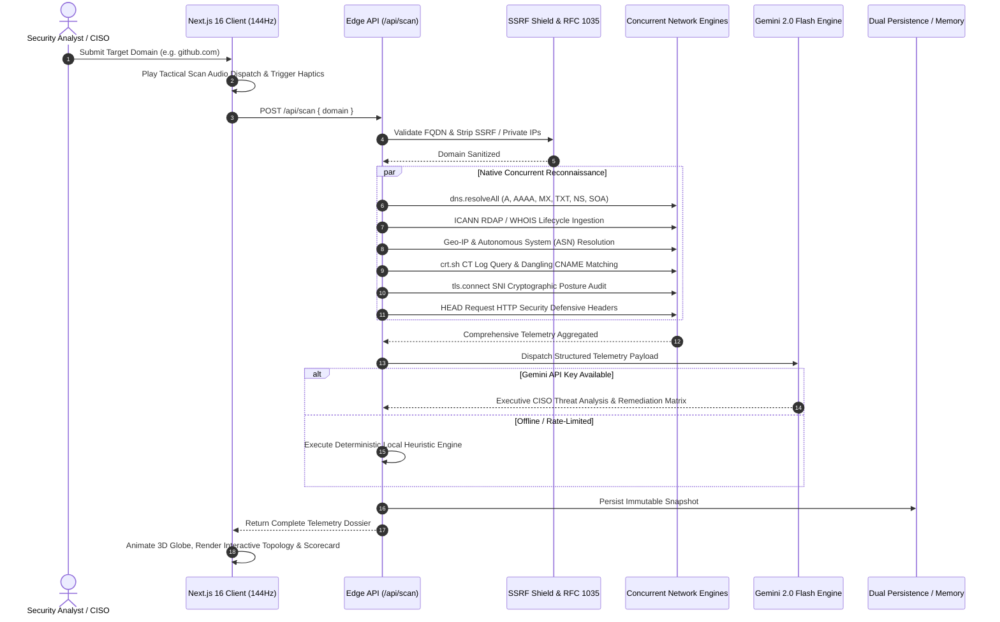

<div align="center">


# SHADOR
### Autonomous Attack Surface & OSINT Reconnaissance Platform

*Next-generation passive external perimeter intelligence, 3D tactical telemetry, and cognitive threat synthesis.*

[](https://nextjs.org/)
[](https://react.dev/)
[](https://www.typescriptlang.org/)
[](https://tailwindcss.com/)
[](https://ai.google.dev/)
[](https://render.com)
[](https://standards.ieee.org/)
[](https://owasp.org/)
[](https://opensource.org/licenses/MIT)

[Explore Features](#-key-capabilities--intelligence-modules) • [3D Tactical Radar](#-3d-tactical-cyber-globe--orbital-telemetry) • [Tech Stack](#-cybernetic-tech-stack) • [Architecture](#-reconnaissance-architecture) • [Quick Start](#-quick-start-local-setup) • [Deployment](#-deployment-on-render) • [Author](#-author--credits)

</div>

---

## 🛡️ Executive Overview

Modern enterprise digital infrastructure is ephemeral, distributed, and multi-cloud. The rapid provisioning and decommissioning of microservices, third-party SaaS integrations, and serverless edge functions give rise to widespread **Shadow IT**—unmonitored external assets, dangling DNS records, expired cryptographic certificates, and missing defensive edge headers.

**SHADOR** is an elite, zero-intrusion, pure Node.js/TypeScript attack surface intelligence platform. Engineered with **Fable 5.1 caliber**, SHADOR combines concurrent native network auditing (`node:dns`, `node:tls`, `node:https`), an orthographic **3D Tactical Cyber Globe**, dynamic relational graph visualization (`@xyflow/react`), and cognitive threat synthesis powered by **Google Gemini 2.0 Flash**.

It delivers comprehensive EASM visibility in sub-6 seconds—with **zero Python dependencies**, **zero invasive payload risks**, and fluid **120/144Hz multi-device responsiveness**.

---

## ✨ Key Capabilities & Intelligence Modules

| Module | Icon | Technical Highlights & Specifications |
| :--- | :---: | :--- |
| **3D Tactical Cyber Globe** | 🌐 | Orthographic mathematical 3D sphere projection rendered on HTML5 Canvas. Features procedural continental nodes, graticule latitude/longitude lines, orbital satellite telemetry, pulsing target beacons, and 360° touch/mouse drag tracking with pointer capture. |
| **Authoritative WHOIS Auditor** | 🔍 | Native ICANN RDAP domain lifecycle auditor. Extracts verified registrar credentials, registration and expiration epochs, precise day-count countdowns, privacy shields, and active domain status flags. |
| **Global Geo-IP & BGP Fabric** | 🗺️ | Real-time physical data center resolution with national flag emojis, WGS 84 GPS coordinates, city/region jurisdiction, Autonomous System Number (ASN), and ISP carrier telemetry. |
| **Interactive Topology Canvas** | 🕸️ | Accelerated relational attack surface graph powered by `@xyflow/react`. Visually maps apex domains, nameservers, mail exchangers, IP endpoints, and subdomains color-coded by defensive posture. |
| **Email Spoofability & DMARC Guard** | ✉️ | Algorithmic SPF mechanism evaluator (`-all`, `~all`, `?all`) and DMARC enforcement classifier (`p=reject`, `quarantine`, `none`). Computes an actionable Email Spoofability Index (0–100) and warns against Business Email Compromise (BEC). |
| **Passive Subdomain & Takeover Scanner**| 🪪 | Zero-footprint Certificate Transparency (CT) log ingestion via `crt.sh`. Cross-references cloud provider signatures (AWS S3, GitHub Pages, Heroku, Azure, Shopify) to flag dangling CNAME pointers susceptible to subdomain takeover. |
| **TLS/SSL Cryptographic Posture** | 🔒 | Pure Node.js TLS handshake to port 443 with SNI. Evaluates certificate expiration countdowns ($\le 14$ days alert), CA root chains, negotiated protocols (`TLSv1.3`/`v1.2` vs deprecated `v1.0`), and self-signed certificates. |
| **HTTP Edge Defensive Headers Scanner** | 🛡️ | Audits 6 critical defensive headers (`Strict-Transport-Security`, `Content-Security-Policy`, `X-Frame-Options`, `X-Content-Type-Options`, `Referrer-Policy`, `Permissions-Policy`) mapped directly to OWASP Top 10 and CWE vectors. |
| **Cognitive Threat Synthesizer** | 🤖 | Powered by **Gemini 2.0 Flash** (`thinkingBudget: 0` for sub-6s synthesis). Generates executive CISO threat briefs, multi-stage adversary attack simulations, and copy-paste remediation diffs with deterministic local heuristic fallback. |
| **Executive CISO PDF Dossier Suite** | 📑 | Print-perfect A4/Letter dossier export generator featuring the Master Cyber Crest, risk score breakdown, WHOIS lifecycle records, Geo-IP telemetry, and Gemini AI narrative. Includes live iframe preview and one-click PDF printing. |
| **Hardening Configuration Studio** | 🛠️ | Custom one-click configuration generator providing ready-to-deploy hardening templates for NGINX (`nginx.conf`), BIND9 authoritative DNS, Terraform, Next.js security headers, and AWS Route 53 CLI cleanup scripts. |
| **Bug Bounty Submission Studio** | 🎯 | Generates professional bug bounty reports pre-filled with CVSS 3.1 severity scores, reproducible `curl`/`dig` PoC commands, CWE classifications, and business impact summaries. |
| **Live Tactical Audio Synthesizer** | 🔊 | Immersive Web Audio API synthesizer generating real-time procedural sci-fi audio cues for radar sweeps, button clicks, scan dispatches, modal triggers, and security alerts. |

---

## 🌐 3D Tactical Cyber Globe & Orbital Telemetry

```
              .-----------------.
           .-'   .-------.       '-.
         .'     /  CYBER  \         '.
        /      |   GLOBE   |          \
       ;       \  360° DRAG/           ;
       |        '---------'   [SAT]     |  <-- Real-Time Lat/Lon Target Lock
       ;       /    \                  ;
        \     /  GEO \                /
         '.  '--------'             .'
           '-.                     .-'
              '-----------------'
```

- **Mathematical Orthographic Projection:** Projects 3D geographic spherical coordinates `(lat, lon, r)` to 2D screen coordinates using pure trigonometric transformation matrices.
- **Natural 1:1 Direct Tracking:** Inverted Y-axis tilt physics with `setPointerCapture` guarantees frictionless rotation without cursor slip across touchscreens and desktop mice.
- **Dual Visual Modes:** Instant toggle between **3D Orbital Globe** and **2D Concentric Tactical Radar Reticle**.

---

## 🏗️ Reconnaissance Architecture



---

## 🛠️ Cybernetic Tech Stack

```text
SHADOR Ecosystem
├── Core Framework:        Next.js 16.4.3 (App Router with Turbopack)
├── UI Runtime:            React 19.3.0 & React DOM 19
├── Type System:           TypeScript 5.x (Strict Typing, 100% Type-Sound)
├── Styling Engine:        Tailwind CSS 3.4.19 (Custom Neon Crimson & Electric Cyan)
├── Cognitive Intelligence: Google Gemini 2.0 Flash via @google/genai
├── Relational Graph:      @xyflow/react 12.12.0
├── Vector Icons:          Lucide React 1.62.0
├── Audio FX Engine:       Web Audio API (Procedural Frequency Synthesizer)
├── Persistence Layer:     Supabase (PostgreSQL with Row Level Security) + In-Memory Cache
└── Cloud Infrastructure:  Render (Turnkey Blueprint with Node 20 LTS)
```

---

## 📁 Repository Structure

```text
shador/
├── public/                     # Static assets, branding logos & SVG vector icons
├── src/
│   ├── app/
│   │   ├── api/
│   │   │   ├── alerts/webhook/ # Multi-channel webhook notification dispatcher
│   │   │   ├── cli/            # Headless terminal CLI execution endpoint
│   │   │   ├── health/         # Production container health probe endpoint
│   │   │   ├── history/        # Historical audit logs & drift tracking
│   │   │   ├── reports/[id]/   # Shareable immutable scan report retrieval
│   │   │   │   └── print/      # Standalone Executive PDF print preview route
│   │   │   └── scan/           # Primary asynchronous reconnaissance orchestrator
│   │   ├── report/[id]/        # Shareable public dossier viewer
│   │   ├── globals.css         # Compiled tactical CSS & cybernetic glows
│   │   ├── layout.tsx          # Root layout with font optimization & audio provider
│   │   └── page.tsx            # Main reconnaissance cockpit & command center
│   ├── components/
│   │   ├── AiThreatReport.tsx             # Cognitive AI threat synthesis & attack simulation
│   │   ├── AuditDashboard.tsx             # High-density security scorecard & metrics grid
│   │   ├── BountySubmissionStudio.tsx     # Bug bounty report generator with CVSS calculator
│   │   ├── CyberBackground.tsx            # Accelerated canvas constellation radar
│   │   ├── GeoLocationRadar.tsx           # Global Geo-IP matrix & radar interface
│   │   ├── HardeningConfigStudio.tsx      # Infrastructure hardening code generator
│   │   ├── IntelligenceExportModal.tsx    # Multi-format export modal (PDF, JSON, CSV, MD)
│   │   ├── Navbar.tsx                     # Tactical squircle brand bar & command triggers
│   │   ├── PentestMethodologyStudio.tsx   # Interactive OWASP pentest checklist & notes
│   │   ├── ScanHero.tsx                   # Main predator input terminal with laser sheen
│   │   ├── TacticalCyberGlobe.tsx         # Orthographic 3D Canvas cyber globe
│   │   ├── TopologyCanvas.tsx             # Relational node graph canvas (@xyflow/react)
│   │   ├── WarRoomDeck.tsx                # DEFCON incident response & collaborative ops
│   │   └── WhoisZoneRadar.tsx             # ICANN RDAP domain lifecycle auditor UI
│   ├── lib/
│   │   ├── ai/gemini-engine.ts            # Gemini 2.0 Flash synthesis & local heuristic fallback
│   │   ├── audio/AudioContext.tsx         # Web Audio API tactical sound effects synthesizer
│   │   ├── export/
│   │   │   ├── intelligence-feed.ts       # Markdown, JSON, CSV & STIX threat export formats
│   │   │   └── pdf-dossier.ts             # Print-perfect CSS A4/Letter Executive PDF generator
│   │   ├── scanner/
│   │   │   ├── dns-auditor.ts             # Concurrent DNS resolution & records evaluation
│   │   │   ├── email-spoof-auditor.ts     # SPF syntax parser & DMARC enforcement classifier
│   │   │   ├── header-auditor.ts          # Safe HTTP HEAD defensive edge headers inspector
│   │   │   ├── network-auditor.ts         # Geo-IP resolution & Autonomous System lookup
│   │   │   ├── ssrf-filter.ts             # RFC 1035 domain normalizer & SSRF perimeter shield
│   │   │   ├── subdomain-auditor.ts       # Certificate Transparency crt.sh query & takeover matcher
│   │   │   ├── tls-auditor.ts             # Node.js TLS port 443 handshake & cipher auditor
│   │   │   └── whois-auditor.ts           # Authoritative ICANN RDAP domain lifecycle auditor
│   │   └── types/scanner.ts               # Core TypeScript definitions & intelligence schemas
├── render.yaml                 # Render cloud web service configuration blueprint
├── package.json                # Dependencies, scripts & pnpm specification
├── tsconfig.json               # TypeScript configuration with strict mode enabled
└── README.md                   # System documentation
```

---

## 🚀 Quick Start (Local Setup)

### Prerequisites

- **Node.js** v20.x or higher
- **pnpm** v10 or higher (`npm install -g pnpm`)
- *(Optional)* **Gemini API Key** from [Google AI Studio](https://aistudio.google.com/apikey)

### 1. Clone the Repository

```bash
git clone https://github.com/AxeyTech/shador.git
cd shador
```

### 2. Install Dependencies

```bash
pnpm install
```

### 3. Configure Environment Variables

Create a `.env.local` file in the root directory:

```env
# Google Gemini Threat Intelligence Engine (Optional - Fallback active if omitted)
GEMINI_API_KEY=your_gemini_api_key_here

# Container Port
PORT=3000

# Optional Supabase Persistence (Uses in-memory cache if omitted)
# NEXT_PUBLIC_SUPABASE_URL=https://your-project.supabase.co
# NEXT_PUBLIC_SUPABASE_ANON_KEY=your-anon-key
# SUPABASE_SERVICE_ROLE_KEY=your-service-role-key
```

### 4. Run the Development Server

```bash
pnpm run dev
```

Open [http://localhost:3000](http://localhost:3000) in your browser to access the tactical reconnaissance console.

### 5. Production Build Verification

```bash
# Type-check and compile Next.js production bundle
pnpm run build

# Start production server
pnpm run start
```

---

## ☁️ Deployment on Render

SHADOR is natively configured for turnkey deployment on **[Render](https://render.com)** using the embedded [`render.yaml`](./render.yaml) blueprint:

1. Push your repository to GitHub:
   ```bash
   git remote add origin https://github.com/AxeyTech/shador.git
   git branch -M main
   git push -u origin main
   ```
2. In the **Render Dashboard**, click **New +** → **Blueprint** (or **Web Service**).
3. Connect your repository. Render will automatically detect `render.yaml` and configure:
   - **Service Name:** `shador`
   - **Environment:** `Node 20.18.0 LTS`
   - **Build Command:** `pnpm install && pnpm run build`
   - **Start Command:** `pnpm run start`
   - **Health Check Path:** `/api/health`
4. In the **Environment Variables** panel, add:
   - `GEMINI_API_KEY`: *(Your Google AI Studio API key)*
5. Click **Apply / Deploy**. Render will provision SSL certificates, run the optimized production build, and launch your live instance at `https://shador.onrender.com`!

---

## 👥 Author & Credits

- **Project Lead & Architect:** Akshay Sharma ([@AxeyTech](https://github.com/AxeyTech))
- **Platform:** **SHADOR** (Autonomous EASM & OSINT Reconnaissance Engine)
- **Standard Compliance:** IEEE Std 830-1998 Software Requirements Specification
- **Security Framework:** OWASP Top 10 • CWE Mitigations • RFC 6797 (HSTS) • RFC 9116 (security.txt)

---

## 📄 License

This project is licensed under the **MIT License** — see the [LICENSE](LICENSE) file for details. Free for educational, research, and enterprise security operations.
